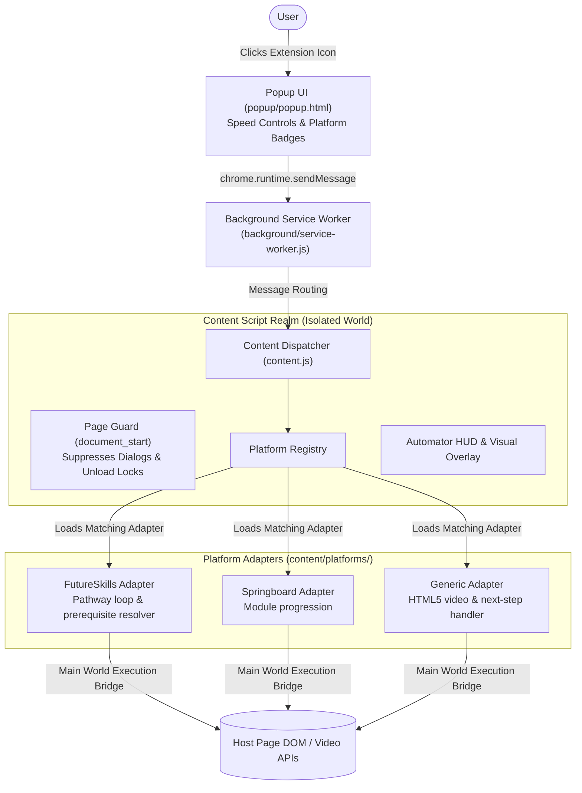

# Speedo — Multi-Platform Course & Test Automator

[](https://developer.chrome.com/docs/extensions/mv3/)
[](https://developer.mozilla.org/en-US/docs/Web/JavaScript)
[]()
[]()

An advanced, modular Google Chrome extension built strictly on **Manifest V3 (MV3)** for automated course navigation, video playback control, and multi-platform learning pathway acceleration (FutureSkills Prime, Infosys Springboard, and Generic HTML5 courseware).

---

## 🏛️ System Architecture

The extension is designed around an extensible **Platform Adapter Pattern**, isolating vendor-specific DOM logic from core orchestration:



---

## ✨ Key Architectural Features

1. **Manifest V3 & CSP Compliance:**
   * Eliminates unsafe `eval()` and dynamically injected `<script>` tags blocked by strict site CSP.
   * Utilizes a secure `EXEC_IN_MAIN_WORLD` messaging bridge via `chrome.scripting.executeScript({ world: 'MAIN' })` to safely hook into page-native video callback handlers (`window.on_video_ended`).
2. **Platform Adapter Pattern:**
   * Every e-learning platform is housed in its own isolated module under `content/platforms/` with dedicated selectors and progression loops.
   * Easily extensible: adding a new LMS platform requires only a new adapter file registered in `platform-registry.js`.
3. **Proactive Page Guard:**
   * Injected at `document_start` to neutralize blocking modals, `alert()` pauses, and page visibility freeze handlers.
4. **Adaptive Playback Engine:**
   * Real-time HTML5 video acceleration with configurable playback multipliers ($1.0\times$ to $16.0\times$).
   * Automatic seek-to-end and completion trigger upon video finalization.

---

## 🚀 Installation & Local Setup

### 1. Clone the Repository
```bash
git clone https://github.com/shutkarshX/Speedo.git
```

### 2. Load into Google Chrome
1. Open Google Chrome and navigate to `chrome://extensions/`.
2. Toggle on **Developer mode** in the top-right corner.
3. Click the **Load unpacked** button.
4. Select the cloned `Speedo` folder from your local disk.
5. The extension will appear in your Chrome toolbar with a speed indicator icon.

---

## 📂 Repository Structure

```text
Speedo/
├── background/
│   └── service-worker.js          # Central MV3 background orchestrator & message broker
├── content/
│   ├── core/
│   │   ├── automator-core.js      # Shared HUD, overlays & MAIN world execution bridge
│   │   └── platform-registry.js   # Dynamic platform detection & registry
│   ├── platforms/                 # Isolated platform adapters
│   │   ├── futureskills/          # FutureSkills Prime automation logic
│   │   ├── springboard/           # Infosys Springboard automation logic
│   │   └── generic/               # Universal HTML5 video player fallback
│   ├── content.js                 # Primary content script dispatcher
│   ├── content.css                # Visual HUD & toast styling
│   └── page-guard.js              # Injected at document_start to defeat modal locks
├── popup/
│   ├── popup.html                 # Extension toolbar popup interface
│   ├── popup.css                  # Modern dark-mode UI styling
│   └── popup.js                   # Speed selector & state management
├── utils/
│   └── dom-helpers.js             # Shared DOM traversal & retry utilities
├── manifest.json                  # Chrome Extension Manifest V3 configuration
└── README.md
```

---

## 📜 Development & Safety Notes
* Built for educational automation, personal accessibility acceleration, and web testing.
* Target-specific selectors and architectural specifications are maintained in `SITE_SPEC.md` and `PLATFORMS.md`.
